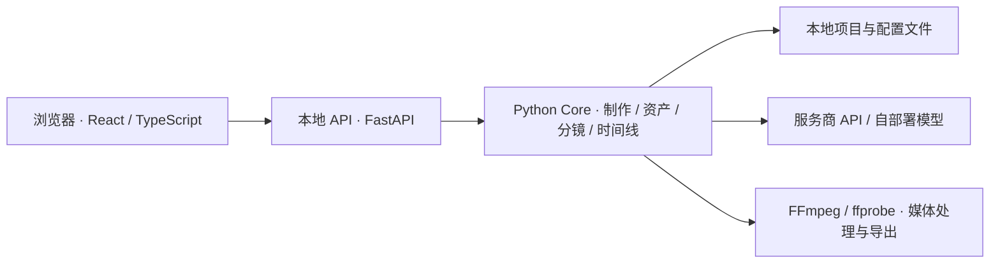

# OpenDirector

**从创作想法到可下载的短片：对话制作、画布管理、分镜采用、时间线导出。**

OpenDirector 是一个在本地运行、通过浏览器使用的 AI 视频创作工作台。它把模型生成与手动编辑放在同一个项目中：用助手规划并制作镜头，在画布中整理和迭代素材，再从分镜板选定版本，预览并导出 MP4。

适合制作分镜短片、验证视觉创意，以及需要反复调整局部镜头的创作流程；它不是完整的非线性视频剪辑器。

> 本文介绍当前源码的使用方式，不代表已完成所有平台与模型组合的发布验收。当前应用界面、包名、启动脚本和配置目录仍使用 **MuseShow / museshow**；下文命令保留这些实际名称，无需自行重命名。

[快速开始](#快速开始) · [模型接入](#模型接入) · [制作第一支短片](#制作第一支短片) · [当前边界](#当前边界) · [开发与贡献](#开发与贡献)

## 能做什么

- **对话驱动制作**：描述目标，由助手生成文本和媒体素材；一个制作计划最多 12 个镜头。
- **画布管理素材**：上传文件、添加参考、生成新版本、查看历史；画布编辑支持撤销与重做。
- **分镜明确采用**：每镜选择主画面和旁白，区分“候选”与“已采用”，避免把每次重做都直接覆盖到成片。
- **局部修复与恢复**：重做单个步骤、保留其他镜头；制作受阻时查看已有结果，按提示继续或核对任务。
- **预览与导出**：按分镜顺序预览画面、原声和旁白，导出 720p / 30 fps MP4。
- **本地项目，自选模型**：项目文件保存在本机，可连接服务商 API 或自部署模型服务。

## 快速开始

### 1. 准备环境

| 依赖 | 要求 |
| --- | --- |
| Node.js 与 npm | Node.js `20.19+`（20.x）、`22.12+`（22.x）或更高的受支持版本 |
| Python | `3.11+` |
| FFmpeg | `ffmpeg` 与 `ffprobe` 均在 PATH 中；导出需要 H.264（`libx264`）与 AAC 编码支持 |
| 模型服务 | 准备可用的服务地址、Model ID，以及服务要求的 API Key / Token |

安装依赖和调用远程模型需要网络。自部署模型的运行环境另行准备；启动本应用不会自动安装或部署模型。只使用远程 API 时，本机不负责模型推理。

先确认媒体工具可用：

```bash
ffmpeg -version
ffprobe -version
```

### 2. 获取源码

```bash
git clone https://github.com/ThinkFlowLab/OpenDirector.git
cd OpenDirector
```

也可下载源码并解压。以下命令均在仓库根目录执行；仓库访问权限以 GitHub 实际设置为准。

### 3. 安装并启动

**macOS / Linux / WSL**

```bash
npm --prefix apps/web ci
python3 -m venv .venv
.venv/bin/python -m pip install -r requirements.txt
npm --prefix apps/web run build
.venv/bin/python scripts/museshow.py serve
```

**Windows PowerShell**

```powershell
npm.cmd --prefix apps/web ci
py -3 -m venv .venv
.\.venv\Scripts\python.exe -m pip install -r requirements.txt
npm.cmd --prefix apps/web run build
.\.venv\Scripts\python.exe scripts/museshow.py serve
```

打开 **<http://127.0.0.1:8000/>**。保持终端运行，按 `Ctrl+C` 停止服务。

- 下次启动只需执行最后一条 `serve` 命令。
- 端口占用时，在该命令后追加 `--port 8001`，访问 `http://127.0.0.1:8001/`。
- 更新源码前先备份项目；更新后重新安装依赖、构建前端并重启服务。

## 模型接入

进入左下角 **设置 → 模型接入**，按需为 **Agent、图片、视频、音频**添加模型。每一类可保存多个配置，并在助手的模型选择器中切换。

配置时需要区分：

1. **接入方式**：服务商 API，或自部署服务（云端 / 本地）。
2. **接口协议**：OpenAI 兼容接口、火山方舟 / Agent Plan，或 vLLM-Omni 视频接口。
3. **服务地址（Base URL）**：必须能从运行 Python 后端的机器访问。
4. **鉴权方式**：API Key / Bearer Token，或无需鉴权；无需鉴权的服务不必填写占位密钥。
5. **Model ID**：填写服务实际提供的名称；自部署服务使用其 served model name。

### 接入示例

以下是配置格式示例，不保证对应账户已开通模型，也不表示所有兼容服务都经过实测。

| 用途 | 接口协议 | Base URL 示例 | Model ID 示例 |
| --- | --- | --- | --- |
| Agent | OpenAI 兼容 | `https://api.deepseek.com` | `deepseek-flash` |
| 图片 | 火山方舟 / Agent Plan | `https://ark.cn-beijing.volces.com/api/plan/v3` | `doubao-seedream-5.0-pro` |
| 视频 | 火山方舟 / Agent Plan | `https://ark.cn-beijing.volces.com/api/plan/v3` | `doubao-seedance-2.0` |
| 语音 | 火山方舟 / Agent Plan | `https://openspeech.bytedance.com/api/v3/plan` | `doubao-seed-tts-2.0` |
| 视频（自部署） | vLLM-Omni 视频接口 | `http://127.0.0.1:18091/v1` | `FastH3-Omni` |
| 视频（自部署） | vLLM-Omni 视频接口 | `http://<服务地址>:8000/v1` | `MiniMaxAI/MiniMax-H3` |
| 图片（自部署） | OpenAI 兼容 | `http://<服务地址>:8000/v1` | `Tongyi-MAI/Z-Image-Turbo` |
| 语音（自部署） | OpenAI 兼容（语音合成） | `http://<服务地址>:8000/v1` | 服务实际提供的 TTS Model ID |

Agent 使用 Chat Completions；OpenAI 兼容图片适配器使用图片生成 / 编辑接口，语音适配器使用 `/audio/speech`。仅声明“OpenAI 兼容”不意味着所有媒体能力都兼容，请核对服务实际协议、返回格式与参考素材限制。

火山引擎配置可参考官方[视觉模型说明](https://docs.volcengine.com/docs/ark/agent-plan-personal-visual-models?lang=zh)和[语音模型说明](https://docs.volcengine.com/docs/ark/agent-plan-personal-voice-model?lang=zh)。

### 自部署模型与参考素材

- **FastH3 / vLLM-Omni 视频接口**：支持图片、视频和音频素材参考；当前适配器默认请求 5 秒、832×480 视频。服务必须实现相应的视频任务接口。
- **MiniMax-H3 专用适配**：Model ID 末段为 `MiniMax-H3` 时启用，支持首帧、素材参考和“接续上一段”。接续依赖同一 H3 服务缓存的上一段潜变量，不是上传任意视频后续写；服务重启或缓存淘汰后可能需要重新生成上一段。
- **Z-Image-Turbo 专用适配**：Model ID 末段为 `Z-Image-Turbo` 时启用，仅按文字出图，输出 1344×768；文档参考会并入提示词，不接受参考图片。批量制作中的关键帧会略过图片参考，角色外观需写入提示词。
- **OpenAI 兼容 TTS**：自部署配置默认请求服务的 `default` 音色，服务商 API 默认请求 `alloy`；服务需支持对应音色。当前不是声音克隆或音乐生成工作流。

SSH 隧道场景请填写本地转发地址。只有在可信的本机 / 隧道环境且服务确实未启用鉴权时，才选择“无需鉴权”。

## 制作第一支短片

1. **选好模型**：在助手中选择 Agent 和需要的媒体模型。先从一个镜头验证接入，再进行批量制作。
2. **描述目标并明确开始制作**：首次发送消息可自动创建项目，也可手动新建。例如：

   > 请制作四个镜头的雨后清晨短片，每镜生成关键帧、视频和中文旁白。

3. **查看制作进度**：到画布检查素材，到分镜板核对每镜已采用的主画面和旁白。
4. **调整局部**：例如“只重做第二镜旁白，保留画面”，或“保留当前版本，只生成候选”。候选需确认采用后才进入成片。
5. **预览并下载**：打开时间线，检查顺序、原声和旁白，点击“导出视频”，填写文件名后下载 MP4。

部分镜头尚未完成时，可以预览已就绪镜头；完整导出需补齐必要素材。遇到失败先看具体任务状态，已有成果会保留，不必直接重新制作整个项目。

### 三个工作区如何配合

| 工作区 | 主要用途 | 重要区别 |
| --- | --- | --- |
| 画布 | 创建文本 / 图片 / 视频 / 音频节点，上传、引用、生成与查看历史版本 | 移除节点保留文件；应用历史版本不自动更改分镜采用 |
| 分镜板 | 新增、排序、复制镜头，选择主画面和旁白 | 浏览候选只是预览，点击“采用”才影响成片 |
| 时间线 | 同步分镜顺序，预览画面、视频原声与旁白，静音轨道或片段，导出 | 不是自由剪辑时间线；视频使用完整时长，图片默认停留 3 秒，可调整 |

**常用操作**

- 双击 / 右键画布或使用底部工具栏创建节点；在输入框上传、粘贴、拖入文件，或输入 `@` 引用项目资产。
- 拖动空白处框选，`Shift` 追加选择；空格拖动平移，`Ctrl` / `Command` + 滚轮缩放。
- `Delete` / `Backspace` 移除选中节点；永久删除文件需到资产列表，并经过引用检查。
- 画布最近 50 步编辑可撤销 / 重做：`Ctrl` / `Command` + `Z`、`Ctrl` / `Command` + `Shift` + `Z`。模型调用与生成结果不回退。
- “历史版本”可查看素材、模型、原始要求与参考；参考使用来源的当前版本。

## 保存、恢复与隐私

- **项目数据**：位于仓库根目录 `projects/`。备份时保留完整项目文件夹；关闭项目后可重命名，对应文件夹会同步改名。制作或导出期间请等待任务完成。
- **模型配置**：位于 `.museshow/models.json`，含 API Key，属于敏感本地文件，不是加密密钥库。不要提交到 Git、分享或附在问题报告中；分享项目和日志前也应检查敏感内容。
- **本地服务**：启动脚本监听 `127.0.0.1`；当前产品面向本机使用，不是带用户账户与权限隔离的公网托管服务。不要直接暴露到公网。
- **模型数据与费用**：本地保存不等于离线推理。提示词及所选参考内容会按请求发送给配置的模型服务；调用费用、数据处理方式和模型使用条款由相应服务决定。
- **关闭页面不等于取消任务**：后端运行时，切换项目或关闭页面后生成仍可继续；停止助手回复也不会停止已开始的制作。“停止后续制作”和“取消已提交任务”作用不同，远端是否已取消需查看任务结果。
- **异常恢复**：保存失败时先处理提示并重试，再切换项目。服务重启后核对制作进度再继续；中断导出可在导出记录中重试已保存的快照。不要把重复提交当作唯一恢复手段，以免产生新的调用费用。

## 当前边界

| 项目 | 当前行为 |
| --- | --- |
| 界面 | 中文，支持浅色 / 深色主题 |
| 制作规模 | 单个制作计划最多 12 个镜头 |
| 上传 | TXT、Markdown、常见图片 / 视频 / 音频；单文件最多 50 MB，UTF-8 文本最多 1 MB |
| 参考能力 | 随模型与模式变化；助手对视频 / 音频使用素材信息，不等同于直接理解完整影音内容 |
| Seedream 5.0 Pro | 最多 10 张参考图 |
| Seedance 2.0 | 首帧模式使用一张图片；素材参考最多 9 张图片和 3 段 WAV / MP3 音频，音频需搭配图片且总时长不超过 15 秒 |
| 声音 | 可保留视频原声、采用旁白；旁白从镜头起点播放，超出镜头的部分会截断并提示 |
| 导出 | MP4，1280×720、30 fps，保持画面比例并补黑边；导出记录支持再次下载与重试 |
| 尚未提供 | 自由裁剪、转场、背景音乐或字幕编辑；音乐 / 音效生成和声音克隆工作流 |

**水印设置**：“设置 → 通用”的“去除水印”默认开启，用于新建图片 / 视频任务的可见“AI生成”水印参数；是否支持取决于模型接口。它不会擦除已有素材的水印。批量计划会固定创建时的设置，继续 / 重试沿用原设置，旧计划保留原行为。

兼容接口、代码中的适配器和自动化测试不等同于每个模型 / 平台都已实测。请先完成小规模生成、恢复与导出验证，再进行正式制作。

## 故障排查

| 现象 | 优先检查 |
| --- | --- |
| 页面无法连接 | 启动终端是否仍运行、端口是否冲突；用 `serve` 或 `dev` 完整启动，而非只启动前端 |
| 提示先构建前端 | 在根目录运行 `npm --prefix apps/web run build`；Windows 可用 `npm.cmd` |
| 模型配置保存成功但生成失败 | 协议与 Model ID 是否匹配、余额 / 权限是否可用、后端能否访问 Base URL、参考类型是否被支持 |
| 自部署语音报音色错误 | 核对接入方式与服务支持的音色；自部署默认请求 `default` |
| H3 无法接续 | 是否同一服务生成、上段任务是否仍有服务端缓存；重启 / 淘汰缓存后重新生成上段 |
| 媒体解析或导出失败 | `ffmpeg` / `ffprobe` 是否在 PATH、编码器是否可用、磁盘空间和文件权限是否正常；安装工具后重启应用 |
| 保存失败 | 保留当前输入，处理磁盘 / 权限提示后重试；不要立即切换项目或删除项目文件 |

## 架构



```text
apps/web/          React + TypeScript + Vite 前端
apps/api/          FastAPI 路由、本地访问约束与聊天入口
packages/core/    Agent、制作调度、领域模型、本地存储与模型适配器
scripts/          本地应用启动脚本
tests/            Python 单元、接口与跨模块流程测试
tools/fasth3/     FastH3 部署辅助工具（非普通启动必需）
```

## 开发与贡献

安装依赖后，使用开发模式启动前后端：

```bash
# macOS / Linux / WSL
.venv/bin/python scripts/museshow.py dev
```

```powershell
# Windows PowerShell
.\.venv\Scripts\python.exe scripts/museshow.py dev
```

访问 <http://127.0.0.1:5173/>。前端修改自动更新，Python 修改后需重启。端口冲突时追加 `--port 8001 --web-port 5174`，并访问 `http://127.0.0.1:5174/`。

提交改动前，运行与改动相关的检查，并注明未执行或失败的部分：

```bash
# macOS / Linux / WSL
.venv/bin/python -m pytest tests
npm --prefix apps/web run build
```

```powershell
# Windows PowerShell
.\.venv\Scripts\python.exe -m pytest tests
npm.cmd --prefix apps/web run build
```

前端 build 包含 TypeScript 检查。部分测试依赖 FFmpeg / ffprobe；测试中的模拟模型服务不能替代真实模型与浏览器端到端验收。

欢迎通过 [Issues](https://github.com/ThinkFlowLab/OpenDirector/issues) 提交问题或讨论改进。请附上系统、Python / Node.js / FFmpeg 版本、复现步骤、预期与实际结果；提供日志前删除密钥和敏感素材。提交 PR 时说明改动范围及验证方式，涉及存储或任务恢复时请覆盖中断、重试与重复操作。

## 致谢与许可

感谢项目贡献者，以及 React、Vite、FastAPI、FFmpeg、vLLM / vLLM-Omni 等上游工具和生态。本项目的适配不代表相关服务商对项目的背书。

仓库包含 [Apache License 2.0](LICENSE)。第三方依赖、模型权重与服务分别遵循各自许可或条款；本仓库许可不替代它们，也不自动授予输入素材或生成内容的权利。
